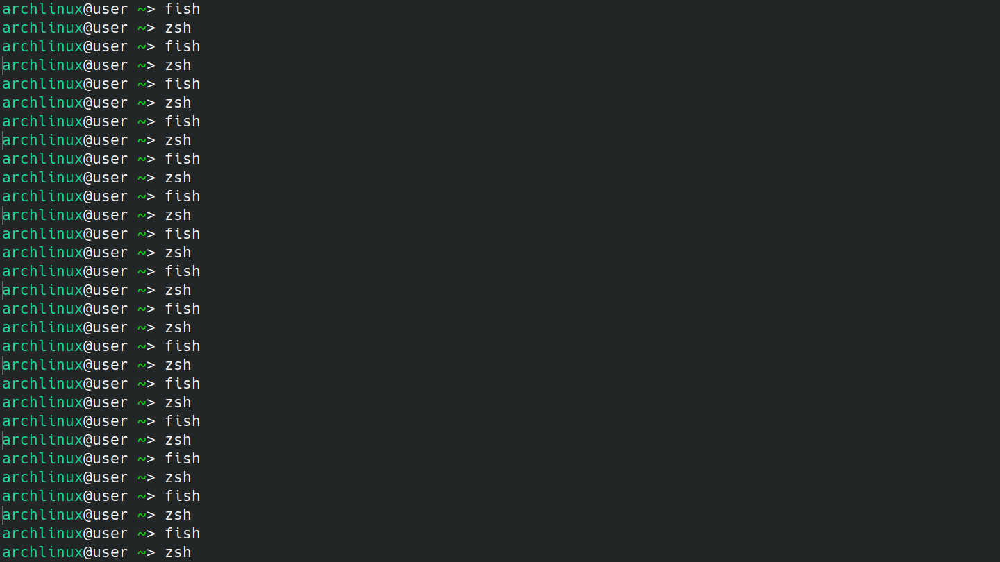

# 🐟 Make Zsh look exactly like Fish again

Make Zsh look and feel **exactly** like the [Fish shell](https://fishshell.com/) — same prompt, same colors, same autosuggestions, same syntax highlighting — while keeping full POSIX compatibility and the Zsh plugin ecosystem.



> Every other line alternates between Fish and Zsh. They are **pixel-identical**.

---

## ✨ Features

| Feature | How it's achieved |
|---|---|
| **Fish-style prompt** (`user@host ~>`) | [Starship](https://starship.rs/) with a custom `starship.toml` |
| **Syntax highlighting** | [zsh-syntax-highlighting](https://github.com/zsh-users/zsh-syntax-highlighting) with Fish's exact color palette |
| **Autosuggestions** | [zsh-autosuggestions](https://github.com/zsh-users/zsh-autosuggestions) (grey inline suggestions, just like Fish) |
| **Tab completion** | Zsh's built-in `compinit` with menu-select and case-insensitive matching |
| **Sane keybindings** | Emacs mode with proper Delete, Ctrl/Alt+Arrow, and word-navigation keys |
| **History** | 10 000 entries, deduplication, shared across sessions |

### Color Palette

The syntax highlighting colors are hand-matched to Fish's defaults:

| Token | Color | Hex |
|---|---|---|
| Commands, builtins, aliases | White | `#ffffff` |
| Paths, options, arguments | Cyan | `#1abc9c` |
| Strings (single & double quoted) | Yellow/Orange | `#f67400` |
| Unknown / invalid commands | Red | `#c0392b` |
| Command separators (`&&`, `\|`, `;`) | Green | `#11d116` |
| Variable expansions | Green | `#11d116` |

---

## 📦 Dependencies

- **[Zsh](https://www.zsh.org/)** 
- **[Starship](https://starship.rs/)** — cross-shell prompt
- **[zsh-syntax-highlighting](https://github.com/zsh-users/zsh-syntax-highlighting)** — Fish-like syntax coloring
- **[zsh-autosuggestions](https://github.com/zsh-users/zsh-autosuggestions)** — Fish-like inline suggestions

---

## 🚀 Installation

### 1. Install dependencies

#### Arch Linux

```bash
sudo pacman -S zsh zsh-syntax-highlighting zsh-autosuggestions starship
```

#### Ubuntu / Debian

```bash
sudo apt install zsh zsh-syntax-highlighting zsh-autosuggestions
curl -sS https://starship.rs/install.sh | sudo sh
```

#### Fedora

```bash
sudo dnf install zsh zsh-syntax-highlighting zsh-autosuggestions
curl -sS https://starship.rs/install.sh | sudo sh
```

### 2. Copy the config files

```bash
cp .zshrc ~/.zshrc
cp starship.toml ~/.config/starship.toml
```

> [!NOTE]
> The plugin source paths in `.zshrc` default to `/usr/share/zsh/plugins/` (Arch Linux).
> If your distro places them elsewhere (e.g. `/usr/share/zsh-autosuggestions/`), uncomment the alternative paths at the bottom of `.zshrc`.

### 3. Set Zsh as your default shell

```bash
chsh -s $(which zsh)
```

Log out and back in — enjoy your new Fish-flavored Zsh! 🎉

---

## 📁 Files

| File | Purpose |
|---|---|
| [`.zshrc`](.zshrc) | Main Zsh configuration — history, keybindings, completion, syntax highlight colors, and plugin loading |
| [`starship.toml`](starship.toml) | Starship prompt config — replicates Fish's default `user@host dir>` prompt |

---

## 🤔 Why not just use Fish?

Fish is great, but:

- It is **not POSIX-compatible** — many scripts and one-liners break.
- Zsh has a **much larger plugin ecosystem** (Oh My Zsh, Zinit, etc.).
- Some tools and environments **assume a POSIX shell**.
- You may already have **Zsh configs and muscle memory** you don't want to lose.

This project gives you the **best of both worlds**: Fish's gorgeous out-of-the-box experience with Zsh's power and compatibility.

---

## 📄 License

This project is open source. Feel free to use, modify, and share.
